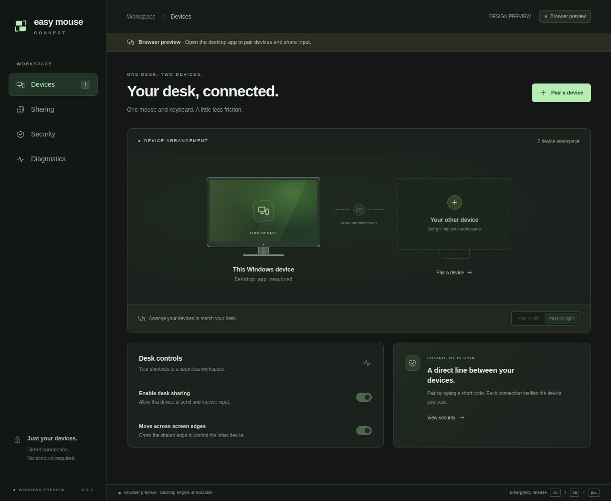

# Easy Mouse Connect

Share a mouse and keyboard between two Windows PCs over an authenticated, encrypted connection. Easy Mouse Connect uses Rust for networking and native input, with Tauri 2 and a small HTML/CSS/JavaScript settings interface.

**Current version: 0.3.5 — Windows x64 preview.** This is development software; the full hardware acceptance matrix and an independent security audit are incomplete. Pair only PCs you trust: input sharing grants the other PC control of your signed-in desktop. See [SECURITY.md](SECURITY.md) for the security model and reporting process.



The image shows the unpaired browser preview of the settings interface.

## Features

| Feature | Behavior |
| --- | --- |
| Mouse and keyboard | Standard Windows mouse buttons, wheel events and keyboard scan codes; move across a configured left/right edge to switch PCs |
| Multiple monitors | Uses Windows display rectangles, including stacked displays, negative coordinates and monitor gaps |
| Direct connections | Enter a reachable IPv4 or IPv6 address; use a routed LAN or an existing VPN such as Tailscale |
| Encrypted pairing | Type a short-lived 12-character code; subsequent connections verify the stored device identity |
| Clipboard | Optional plain-text sharing, off by default, up to 1 MiB |
| Files | Optional app-based transfer, off by default, with recipient approval; each file must be smaller than 100,000,000 bytes |
| Tray controls | Open, Pause/Resume, Stop sharing and Quit; closing the window keeps sharing available in the tray |
| Diagnostics | Local rolling logs capped at 3 × 2 MiB and a user-controlled diagnostic ZIP export |

Input capture, encryption and networking stay in Rust. Mouse events do not pass through the settings WebView. The installed app has no Node server or runtime JavaScript package dependencies.

## Install and pair

Use the same version on both PCs. A Windows preview package contains a per-user installer and a portable executable. Microsoft Edge [WebView2 Runtime](https://developer.microsoft.com/en-us/microsoft-edge/webview2/) is required; Rust and Node are needed only when building from source. Preview packages are unsigned, so Windows may show a publisher or reputation warning.

1. Install the app locally on each PC, or run a local copy of the portable executable. Each PC creates its own identity; do not copy identity or settings data between PCs.
2. Make the destination reachable on TCP port **24859**. Different LAN subnets need a route. Across separate networks, use an existing VPN such as Tailscale and enter the other PC's VPN address. Entering a private IP does not create a route. See [network setup](docs/networking.md) for route and scoped firewall checks.
3. On PC B, open **Devices → Pair a device → Show a pairing code → Generate code**.
4. On PC A, choose **Connect to a device**, enter B's IP address and type B's 12-character code. No shared clipboard or file is needed. The code expires after five minutes or five failed/abandoned attempts; generate a fresh code after either limit and keep it private.
5. Set **Peer on left/right** on each PC to match the other PC's physical position. The two settings should be opposite. Enable **Desk sharing** and **Move across screen edges**.
6. Keep local input available on both PCs and test **Ctrl+Alt+Escape** before relying on remote control. Release local keys/buttons, then move outward through the configured exposed side edge. Moving between monitors on the same PC stays local. Corners and offset monitor shoulders have a small handoff margin.

The PC that entered the code initiates automatic reconnect attempts every three seconds while sharing is enabled. Use **Reconnect** from that PC; the code-generating PC listens for connections. An IP address or device name never substitutes for the paired identity.

Close hides the window. Open it again from the tray, Start menu or desktop shortcut; a second launch focuses the existing instance. Use tray **Quit Easy Mouse Connect** to exit. **Pause** or **Stop sharing** releases input and stops sharing until re-enabled. **Forget device** revokes trust and requires explicit pairing to restore it.

## Clipboard and files

In **Sharing**, enable each desired feature on **both PCs**. Clipboard sharing sends plain text up to **1 MiB**. Copy new text after connecting; enabling the feature does not immediately send the existing clipboard. Pairing-code-shaped text and legacy invitations are excluded from clipboard synchronization.

For files, enable **Allow file transfers**, drop a regular file into the app, select **Send file**, and choose **Accept file** on the receiving PC. Files must be **smaller than 100,000,000 bytes**; the exact limit and larger files are rejected. The default destination is `%USERPROFILE%\Downloads\EasyMouseConnect\<transfer-id>\<filename>` on the recipient. Sharing displays the receiving directory. Each transfer gets its own generated child directory; existing files are never overwritten.

Transfers use length and SHA-256 checks and Windows internet-zone marking before the final save. The sender reports success only after the recipient confirms completion. Received files are never opened or executed automatically. Interrupted transfers do not resume automatically. Direct Explorer-to-Explorer dragging across PCs is not implemented.

## Update or uninstall

Quit both tray apps before installing an update, then use the same version on both PCs. Keep `%LOCALAPPDATA%\EasyMouseConnect\identity.dat`: versions 0.2.0 through 0.3.5 preserve existing identities/settings and established paired peers. **Do not forget a working peer just to upgrade.** Update both PCs before creating a new pairing.

Uninstall through **Windows Settings → Apps → Installed apps**, using **Easy Mouse Connect** or **Easy Mouse Connect Preview** for the small preview installer. Its Start menu also has an uninstall entry. Quit the tray app first. Uninstall removes the installed app, shortcuts and registration while preserving identities/settings, diagnostics and received files. The portable executable creates no uninstall entry.

## Diagnostics and support

Open **Diagnostics** for routing state, connection checks and aggregate input/processing counters. Network round-trip time does not measure end-to-end input latency.

Logs are stored in `%LOCALAPPDATA%\EasyMouseConnect\logs` as `emc.log`, `emc.1.log` and `emc.2.log`, at most **2 MiB each / 6 MiB total**. Records contain typed operational events and failure categories. They exclude raw keys/input, typed text, clipboard/file contents, credentials, file names/paths, peer IPs and device names.

**Export diagnostic ZIP** creates `%LOCALAPPDATA%\EasyMouseConnect\diagnostic-exports\emc-diagnostics.zip`. It includes sanitized log records and numeric/boolean status, including aggregate counters and display dimensions, but no identity/settings files. Each export replaces that one archive; copy an older export elsewhere first if needed. Nothing uploads automatically. Review ZIPs and screenshots before sharing them.

For ordinary bugs, use [GitHub issues](https://github.com/bigsk1/easy-mouse-connect/issues) with the app version, Windows versions, minimal reproduction, affected direction and relevant redacted diagnostics. [Troubleshooting](docs/troubleshooting.md) explains collection and counter interpretation. Report vulnerabilities [privately](https://github.com/bigsk1/easy-mouse-connect/security/advisories/new) using the process in [SECURITY.md](SECURITY.md).

## Current limits

- Windows x64 user-session input only. Linux supports portable protocol/core development, not desktop input sharing.
- Elevated applications, UAC prompts, the lock screen and secure desktops are outside the supported control scope. The app does not request elevation, install a service or change Windows security settings.
- The sending PC's pointer remains parked at its edge; intentional source-pointer hiding is not implemented.
- A receiving cursor fallback can be covered by some shell/fullscreen surfaces. Intentional application cursor hiding can also be overridden by the conservative fallback.
- Standard Logitech events use Windows input paths, but compatibility across all devices, high polling rates, vendor gestures and remapped/injected macros is not guaranteed. Unsupported absolute raw devices release control.
- Return crossing has no exit-height metadata, so it does not preserve the exact vertical position between PCs.
- Clipboard images, automatic discovery, automatic NAT traversal and direct Explorer-to-Explorer file dragging are not implemented. The app creates no firewall exceptions automatically.
- Input overload, stale work or native failure ends the session and releases local input rather than replaying a backlog. The local processing/send budget is 200 ms; a low network RTT does not rule out native processing delays.

## Build from source

Use a native Windows PowerShell terminal for the desktop build. Install:

1. [Visual Studio Build Tools](https://visualstudio.microsoft.com/visual-cpp-build-tools/) with **Desktop development with C++** and a Windows SDK.
2. [Rust via rustup](https://www.rust-lang.org/tools/install), using the MSVC host toolchain. This workspace requires Rust **1.99 or newer** and is tested with 1.99.
3. [Node.js LTS](https://nodejs.org/en/download), for development tooling.
4. [Microsoft Edge WebView2 Runtime](https://developer.microsoft.com/en-us/microsoft-edge/webview2/), if absent.

These follow [Tauri's Windows prerequisites](https://v2.tauri.app/start/prerequisites/#windows).

```powershell
git clone https://github.com/bigsk1/easy-mouse-connect.git
cd easy-mouse-connect
rustup component add rustfmt clippy
.\scripts\setup-windows.ps1 -InstallDevDependencies
.\scripts\check.ps1
.\scripts\dev.ps1
```

If PowerShell policy blocks scripts, inspect them and use `Set-ExecutionPolicy -Scope Process Bypass` in that terminal before retrying. The helpers do not change machine policy or install system prerequisites.

Build the Windows installer with:

```powershell
.\scripts\build-windows.ps1
```

Tauri writes the NSIS installer under `target\release\bundle\nsis\`. The first build requires network access for dependencies and packaging tools. See [preview packaging](packaging/README.md) for the alternative small NSIS recipe.

Portable checks can run without desktop WebView dependencies:

```sh
cargo fmt --all -- --check
cargo test --locked -p emc-protocol -p emc-core -p emc-platform
cargo clippy --locked -p emc-protocol -p emc-core -p emc-platform --all-targets -- -D warnings
node --check ui/app.js
```

Run browser checks with `npm ci`, `npx playwright install chromium`, then `npm run test:ui`. Use `npm run preview` for the settings preview. Browser tests use synthetic native responses; they do not establish native Tauri or two-PC behavior. Windows `scripts/check.ps1` also selects six isolated native API contracts; those install no hooks, inject no real input and access no app profile.

See [CONTRIBUTING.md](CONTRIBUTING.md), [development checks](docs/development.md), [architecture](docs/architecture.md), [protocol](docs/protocol.md) and [manual acceptance cases](docs/manual-testing.md) for development guidance. Input, crypto and networking live in `crates/`; the Tauri shell is in `apps/desktop/`, and the vanilla settings interface is in `ui/`.

## License

Copyright (c) 2026 bigsk1. Licensed under the [MIT License](LICENSE).

